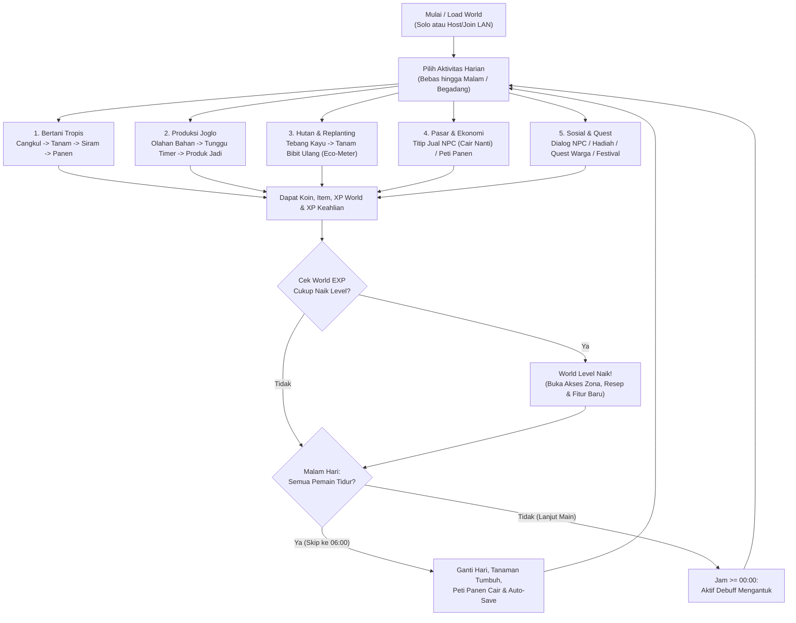
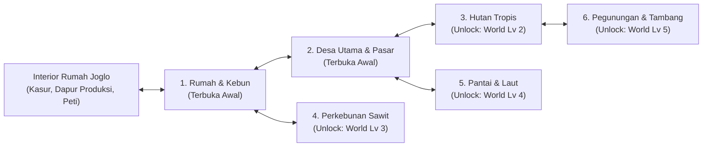

# Product Requirements Document (PRD) — Nusantara Farm: Petualangan Desa

**Versi Dokumen:** 1.0  
**Target Engine:** Godot Engine 4.x (`GL Compatibility`)  
**Target Rilis:** Cross-Platform Android & PC (Windows/Linux)  

---

## Daftar Isi
1. [Ringkasan Produk & Visi](#1-ringkasan-produk--visi)
2. [Core Gameplay Loop & Sistem Progresi](#2-core-gameplay-loop--sistem-progresi)
3. [Sistem Waktu, Cuaca, Musim Tropis & Tidur](#3-sistem-waktu-cuaca-musim-tropis--tidur)
4. [Struktur Dunia Semi-Open World & Zona Map](#4-struktur-dunia-semi-open-world--zona-map)
5. [Sistem Pertanian, Komoditas Tropis & Produksi](#5-sistem-pertanian-komoditas-tropis--produksi)
6. [Sistem Ekonomi, Pasar Konsinyasi & Peti Panen](#6-sistem-ekonomi-pasar-konsinyasi--peti-panen)
7. [Sistem Sosial, NPC, Quest & Festival Desa](#7-sistem-sosial-npc-quest--festival-desa)
8. [Sistem K3LH (Kesehatan, Keselamatan & Lingkungan)](#8-sistem-k3lh-kesehatan-keselamatan--lingkungan)
9. [Spesifikasi Fitur Ekspansi (Fase 2)](#9-spesifikasi-fitur-ekspansi-fase-2)
10. [Desain UI/UX, HUD & Kontrol Cross-Platform](#10-desain-uiux-hud--kontrol-cross-platform)
11. [Mode Multiplayer Co-op LAN / Hotspot](#11-mode-multiplayer-co-op-lan--hotspot)
12. [Persyaratan Non-Fungsional & Acceptance Criteria](#12-persyaratan-non-fungsional--acceptance-criteria)

---

## 1. Ringkasan Produk & Visi

### 1.1 Konsep Utama
**Nusantara Farm: Petualangan Desa** adalah game simulasi pertanian, manajemen sumber daya, dan petualangan sosial berestetika **pixel art 16-bit tropis** yang berlatar pedesaan Indonesia. Pemain berperan sebagai petani muda (**Budi** atau **Mitha**) yang mengelola lahan warisan keluarga di samping rumah adat Joglo, mengolah hasil bumi menjadi produk bernilai tinggi, berinteraksi dengan warga desa yang hangat, serta menjaga kelestarian alam sekitar — baik secara **Single-Player** maupun **Co-op LAN / Hotspot hingga 4 pemain**.

### 1.2 Diferensiasi & Inspirasi
| Referensi | Elemen yang Diadopsi | Adaptasi Khas Nusantara Farm |
| :--- | :--- | :--- |
| **Stardew Valley** | Eksplorasi semi-open world, hubungan NPC, siklus hari & cuaca, keahlian bertani | Latar Joglo, pasar beratap kain batik, komoditas tropis Indonesia, 2 musim (Kemarau & Penghujan), dan **tidur opsional** dengan debuff Mengantuk. |
| **Hay Day** | Rantai pengolahan bahan mentah menjadi produk bernilai tinggi & pemenuhan pesanan | Stasiun produksi tradisional di dalam rumah Joglo (mis. Pisang + Minyak → Keripik Pisang) dan sistem titip jual Pasar. |
| **Minecraft (LAN Co-op)** | Konsep *world* milik Host yang bisa dimasuki teman di Wi-Fi/Hotspot yang sama serta konsensus tidur bersama | 1 Kebun & World Level bersama, sementara Koin, Tas Pinggang, dan Keahlian bersifat pribadi per pemain. |

### 1.3 Target Pasar & Audiens
- **Rentang Usia:** 10–30 tahun (pelajar, mahasiswa, gamer kasual, hingga penggemar *cozy farming sim*).
- **Platform Utama & Sekunder:**
  - **Android (Mobile-First):** Akses mudah untuk bermain santai di mana saja atau mabar via hotspot sekolah/nongkrong.
  - **PC (Windows/Linux — Itch.io/Steam):** Presisi kontrol keyboard + mouse serta visual pixel art tajam di layar besar.

### 1.4 Empat Pilar Desain
1. **Autentik Indonesia:** Seluruh komoditas (Padi, Pisang, Kopi, Kelapa, Kelapa Sawit), arsitektur (Joglo, Gapura, Balai Desa, Kios Batik), dialog, hingga festival (Tumpeng Panen) merefleksikan budaya Nusantara.
2. **Cozy & Ramah Keluarga:** Tanpa pertarungan/kekerasan (*zero combat*), tempo santai, dan mendorong kebiasaan bermain sehat.
3. **Gotong Royong Co-op:** Bermain solo tetap lengkap; bermain beramai-ramai via LAN mempercepat pengerjaan kebun besar, pembukaan zona, dan penyelesaian target World Level.
4. **Edukasi Tropis & Kesadaran Lingkungan:** Sistem 2 musim nyata memengaruhi pertumbuhan tanaman, dan kelestarian hutan berdampak langsung pada kondisi desa dan reputasi pemain.

---

## 2. Core Gameplay Loop & Sistem Progresi

### 2.1 Gameplay Loop Utama

### 2.2 Dual-Tier Progression: World Level (Shared) vs Keahlian (Individual)

Sesuai kesepakatan desain, sistem progresi dipisahkan secara tegas antara progresi dunia dan keterampilan pribadi pemain:

#### A. World Level (Satu Level untuk Seluruh World)
- **Fungsi:** Mengukur kemajuan pembangunan kebun & desa secara kolektif. Di mode Co-op, **semua pemain di dalam world memiliki World Level yang sama** dan setiap aksi produktif dari pemain mana pun menyumbang EXP ke tabungan *World EXP*.
- **Perolehan World EXP:**
  - Panen 1 tanaman: `+10 EXP` (Padi/Sawit/dll. dapat memiliki pengali kecil pada komoditas tingkat tinggi).
  - Mengambil 1 produk jadi dari Stasiun Produksi Joglo: `+10 EXP` s/d `+25 EXP`.
  - Mencairkan penjualan di Konsinyasi Pasar / Peti Panen: `+10 EXP` per paket transaksi.
  - Menanam ulang bibit pohon di Hutan: `+8 EXP`.
  - Menyelesaikan Quest NPC: `+30 EXP` s/d `+150 EXP`.
- **Tabel Kurva World Level (Lv 1 – Lv 10):**

| World Level | Total EXP Dibutuhkan ke Level Berikutnya | Pembukaan Utama (Unlocks) |
| :-: | :-: | :--- |
| **Lv 1** | `50 EXP` | Awal permainan: Rumah & Kebun, Desa Utama & Pasar, Komoditas dasar (Padi, Pisang), Stasiun Goreng Joglo (Keripik Pisang). |
| **Lv 2** | `150 EXP` | Membuka syarat akses **Hutan Tropis**, resep Kopi Sangrai & Beras Pulen, bibit Kopi di Pasar. |
| **Lv 3** | `500 EXP` | Membuka syarat akses **Perkebunan Sawit**, bibit Kelapa Sawit & Minyak Sawit Joglo (selaras referensi UI `Lv 3: 120/500`). |
| **Lv 4** | `850 EXP` | Membuka syarat akses **Pantai & Laut**, resep Santan Kelapa, slot Konsinyasi Pasar tambah +2. |
| **Lv 5** | `1.300 EXP` | Membuka syarat akses **Pegunungan & Tambang**, serta fitur Fase 2 (Memancing, Tambang, Kandang Unggas). |
| **Lv 6–10** | `+600 EXP / level` | Upgrade kapasitas alat tingkat lanjut, perluasan lahan Kebun Utama, dan resep olahan spesial Festival/Ekspor. |

#### B. Keahlian Individual (Per Pemain — Tampil di Layar *Profil Pak Tani*)
Setiap pemain memiliki 4 keahlian inti (dan 3 keahlian Fase 2) dari **Level 1 hingga Level 10**:
1. **Cangkul:** Naik EXP saat mencangkul tanah/membersihkan gulma. Efek per level: `-5%` konsumsi Stamina cangkul; di Lv 5 membuka cangkul *area 3 petak* (tahan tombol).
2. **Siram:** Naik EXP saat menyiram tanaman. Efek per level: kapasitas air gembor naik `+10%` dan hemat stamina `-5%`.
3. **Panen:** Naik EXP saat memanen hasil kebun/hutan. Efek per level: peluang `+4%` mendapat hasil panen ekstra (`+1` item) per level.
4. **Produksi:** Naik EXP saat mengolah bahan di Stasiun Joglo. Efek per level: mempercepat durasi proses mesin `-4%` dan di Lv 5+ peluang hasil ganda `10%`.
5. *(Fase 2)* **Memancing**, **Menambang**, **Beternak**: Naik melalui aktivitas masing-masing untuk meningkatkan efisiensi stamina & kualitas hasil.

---

## 3. Sistem Waktu, Cuaca, Musim Tropis & Tidur

### 3.1 Skala Waktu & Siklus Siang-Malam
- **Rasio Waktu:** `1 hari in-game = 24 menit waktu nyata` (`1 jam in-game = 1 menit / 60 detik waktu nyata`).
- **Tampilan Jam HUD:** Diperbarui per kelipatan 10 menit in-game (`10 detik real-time` = `+10 menit in-game`).
- **Awal Hari:** `06:00` pagi.
- **Fase Pencahayaan (`CanvasModulate`):**
  - `06:00 – 08:59` (Pagi): Hangat keemasan lembut.
  - `09:00 – 15:59` (Siang): Terang cerah alami.
  - `16:00 – 18:29` (Sore/Senja): Jingga kemerahan hangat.
  - `18:30 – 23:59` (Malam): Biru gelap sejuk; lampu obor/lentera rumah Joglo & pos ronda menyala.
  - `00:00 – 05:59` (Tengah Malam / Dini Hari): Gelap pekat; memicu kondisi begadang.

### 3.2 Kalender & 2 Musim Tropis Indonesia
Satu tahun in-game terdiri dari **28 Hari** yang terbagi rata menjadi **2 Musim**:

| Musim | Rentang Hari | Distribusi Cuaca | Efek Gameplay Utama |
| :--- | :---: | :--- | :--- |
| **Musim Kemarau** | Hari 1 – 14 | Cerah (`70%`), Berawan (`25%`), Panas Terik (`5%`) | Tanaman butuh disiram rutin setiap hari; penguapan tanah cepat. Bonus rasa/hasil untuk **Pisang**, **Kelapa**, **Sawit**, dan **Cabai**. |
| **Musim Penghujan** | Hari 15 – 28 | Hujan Ringan (`50%`), Hujan Deras (`20%`), Berawan (`20%`), Cerah (`10%`) | Saat cuaca **Hujan**, seluruh petak sawah/kebun otomatis **tersiram penuh** (hemat Stamina!). **Padi** tumbuh `+1 hari` lebih cepat atau berpeluang hasil ganda. |

- **Pergantian Hari Otomatis tanpa Tidur:** Jika seluruh pemain memilih begadang hingga melewati jam `05:59` -> `06:00`, tanggal kalender tetap bertambah `+1 hari` pada `06:00`, namun pemain yang tidak beristirahat tetap membawa **Debuff Mengantuk** hingga tidur/istirahat.

### 3.3 Aturan Tidur Opsional & Debuff Mengantuk
1. **Syarat Jam Tidur:** Interaksi dengan kasur di dalam **Rumah Joglo** untuk tidur hanya diizinkan pada **malam hari (`18:00 – 05:59`)**. Pada rentang `06:00 – 17:59`, sistem menolak tidur untuk skip hari dan menampilkan dialog sistem: *"Hari masih terang! Tidur hanya bisa dilakukan pada malam hari."* (Pemain tetap dapat duduk di kursi teras Joglo untuk memulihkan Stamina pelan secara opsional).
2. **Konsensus Tidur (Mode Co-op LAN):**
   - Mengikuti pola Minecraft: apabila terdapat `N` pemain online, **seluruh `N` pemain** harus berada dalam status tidur di Joglo agar hari melompat ke `06:00` esok pagi.
   - HUD menampilkan status ringan: `[Nama Pemain] sedang tidur (1/3)` tanpa mengganggu pemain lain.
   - **Tidur / Istirahat Sendiri:** Jika hanya sebagian pemain tidur sementara pemain lain tetap beraktivitas, pemain yang berbaring di kasur memulihkan Stamina (`+15 Stamina / 5 detik real-time`) dan menghapus **Debuff Mengantuk** setelah 10 detik istirahat, tanpa memaksa waktu melompat ke pagi.
3. **Mekanik Debuff Mengantuk:**
   - **Pemicu:** Jam melewati `00:00` tanpa tidur/istirahat malam yang memadai, atau keesokan paginya jika begadang penuh.
   - **Dampak Visual & Audio:** Vignette layar menjadi redup/agak gelap, muncul ikon mata mengantuk di HUD, animasi karakter sesekali menguap, dan musik sedikit melambat/lebih lembut.
   - **Dampak Gameplay:**
     - Kecepatan gerak karakter berkurang **`-25%`** (mis. dari `120 px/s` menjadi `90 px/s`).
     - Konsumsi Stamina tiap penggunaan alat meningkat **`+25%`**.
   - **Cara Menghilangkan:** Beristirahat/tidur di kasur Joglo pada malam hari, atau minum **Kopi Seduh Nusantara** untuk menunda efek mengantuk selama `4 jam in-game`.

---

## 4. Struktur Dunia Semi-Open World & Zona Map

### 4.1 Peta Koneksi Zona

### 4.2 Detail 6 Zona Outdoor & Interior Bangunan

| No | Nama Zona | Status Awal | Syarat Pembukaan (Unlock) | Fitur & Aktivitas Utama |
| :-: | :--- | :---: | :--- | :--- |
| 1 | **Rumah & Kebun** (+ Interior **Joglo**) | Terbuka | Tersedia dari Hari ke-1 | Lahan bercocok tanam utama, sungai kecil penyiraman (isi gembor), Peti Panen, Peti Penyimpanan Bersama, Kasur & Dapur Produksi Joglo, area Kandang (Fase 2). |
| 2 | **Desa Utama & Pasar** | Terbuka | Tersedia dari Hari ke-1 | Gapura selamat datang, Balai Desa (Papan Quest & status Eco-Meter), Kios Pasar beratap batik (Nisrina & Mas Leon), Rumah Pak Tani & Kepala Desa, Jembatan kayu, Alun-alun Festival Panen. |
| 3 | **Hutan Tropis** | Terkunci | **World Lv 2** + Quest Pak Tani (*"Bersihkan Jalan ke Hutan"*) + `50 Koin` | Sumber Kayu Keras & Kayu Tropis, buah liar (Pisang hutan/Jamur/Rempah), lahan wajib **Replanting** pohon yang dipantau oleh **Eco-Meter**. |
| 4 | **Perkebunan Sawit** | Terkunci | **World Lv 3** + Quest Kepala Desa + `15 Kayu` & `200 Koin` perbaikan gerbang | Area khusus lahan tropis luas untuk menanam **Kelapa Sawit** dan pohon buah skala besar secara gotong royong. |
| 5 | **Pantai & Laut** | Terkunci | **World Lv 4** + Quest Nelayan Bahri + `25 Kayu` & `400 Koin` perbaikan Jembatan Selatan | Pesisir pasir tropis, pohon Kelapa pantai, foraging kerang & garam laut (bahan resep!), serta Dermaga Memancing (Fase 2). |
| 6 | **Pegunungan & Tambang** | Terkunci | **World Lv 5** + Quest Kepala Desa + `500 Koin` pembukaan jalur longsor | Kaki gunung berapi ikonik Nusantara, titik tambang damai bebas monster (Fase 2), dan mata air pegunungan. |

> **Mode Pengembangan:** `DEV_UNLOCK_ALL_ZONES = true` di `WorldStateManager` membuat semua zona terbuka sejak awal — gerbang tidak muncul, portal bisa dipakai, dan peta tidak menampilkan label "[Terkunci]". Set ke `false` saat ingin memakai aturan unlock normal.

> **Catatan Aturan Multiplayer Zona:** Setiap pemain dalam sesi Co-op LAN dapat berada di zona yang berbeda secara bersamaan (misal Pemain 1 di Kebun, Pemain 2 menjual barang di Pasar, Pemain 3 menebang & replanting di Hutan). Perubahan lingkungan (pohon ditebang, lahan dicangkul, gerbang zona terbuka) tetap tersinkronisasi untuk seluruh world.

---

## 5. Sistem Pertanian, Komoditas Tropis & Produksi

### 5.1 Mekanisme Lahan Pertanian (`FarmPlot`)
Setiap petak tanah berukuran `16x16 px` memiliki state terpisah:
1. **Rumput / Semak / Batu Kecil:** Harus dibersihkan dengan Cangkul/Sabit/Kapak sesuai objek.
2. **Tanah Kosong:** Siap dicangkul (biaya dasar `2 Stamina`).
3. **Tanah Tercangkul (Kering):** Siap ditanami benih/bibit. Jika tidak ditanami dalam `3 hari`, kembali menjadi tanah kosong.
4. **Tanah Tercangkul (Disiram):** Berubah warna menjadi cokelat gelap lembap; memajukan progres tumbuh tanaman sebanyak `1 hari` saat pergantian hari (`06:00`).
5. **Tanaman Tumbuh (`Stage 0 .. N`):** Visual berubah bertahap sesuai progres hari.
6. **Siap Panen (`Mature`):** Muncul kilau halus / indikator interaktif. Setelah dipanen:
   - *Tanaman Sekali Panen* (Padi, Cabai): tanaman hilang, petak kembali ke tanah tercangkul.
   - *Tanaman Panen Berulang* (Pisang, Kopi, Kelapa, Kelapa Sawit): tetap berdiri sebagai pohon/rumpun dewasa dan dapat berbuah kembali tiap siklus `N` hari tanpa perlu menanam bibit ulang.

### 5.2 Katalog Komoditas Tropis

| Komoditas | Kategori | Musim Optimal | Durasi Tumbuh | Panen Berulang | Harga Bibit | Harga Jual Dasar (Peti) | Nilai Edukasi Lokal |
| :--- | :--- | :--- | :---: | :---: | :-: | :-: | :--- |
| **Padi Lokal** | Pangan Utama | **Penghujan** (tumbuh 4 hari di hujan, 5 hari di kemarau) | 4–5 Hari | Tidak (dapat 2–3 ikat padi) | `20 Koin` | `45 Koin` | Tanaman pokok Indonesia; membutuhkan pengairan cukup dan subur saat musim hujan. |
| **Pisang Raja** | Buah Tropis | **Sepanjang Tahun** (Bonus di Kemarau) | 6 Hari | Ya (tiap 3 hari, 3–4 sisir) | `60 Koin` | `35 Koin / sisir` | Bahan baku utama Keripik Pisang khas UMKM desa. |
| **Kopi Nusantara** | Perkebunan | **Sepanjang Tahun** | 7 Hari | Ya (tiap 4 hari, 3 biji kopi) | `80 Koin` | `45 Koin` | Komoditas dataran tinggi kebanggaan ekspor Indonesia; bahan Kopi Seduh anti-kantuk. |
| **Kelapa Hijau** | Pesisir/Kebun | **Kemarau** & **Sepanjang Tahun** | 8 Hari | Ya (tiap 4 hari, 2 butir) | `100 Koin` | `70 Koin` | Pohon serba guna: menghasilkan air segar, santan, dan bahan Tumpeng. |
| **Kelapa Sawit** | Perkebunan | **Sepanjang Tahun** (Optimal di Zona Sawit) | 9 Hari | Ya (tiap 4 hari, 2 tandan) | `150 Koin` | `95 Koin` | Komoditas industri strategis untuk diolah menjadi minyak goreng/nabati. |
| **Cabai & Rempah** | Bumbu Lokal | **Kemarau** | 4 Hari | Ya (tiap 2 hari, 2 buah) | `30 Koin` | `30 Koin` | Pelengkap masakan desa, quest Nisrina, dan syarat Festival Tumpeng. |
| **Bibit Pohon Hutan** | Reboisasi K3LH | **Sepanjang Tahun** | 5 Hari | Tidak (Ditebang → Kayu) | `10 Koin` / Gratis dari biji pohon | `15 Koin` (Kayu) | Menjaga keseimbangan Eco-Meter hutan agar tidak terjadi eksploitasi liar. |

### 5.3 Sistem Produksi & Pengolahan (Stasiun Rumah Joglo)
Di dalam interior **Rumah Joglo** (dan nantinya stasiun khusus di kebun untuk World Level tinggi), pemain dapat mengolah bahan mentah menjadi barang bernilai jual tinggi atau item fungsional.

| Produk Jadi | Stasiun / Alat | Bahan Input | Waktu Proses | Harga Jual Dasar | Bonus / Fungsi Khusus |
| :--- | :--- | :--- | :---: | :-: | :--- |
| **Keripik Pisang** | Wajan Dapur Joglo | `10 Pisang` + `1 Minyak Goreng/Sawit` | `2 Jam in-game` | `480 Koin` | Dapat dimakan (`+35 Stamina`); komoditas primadona Pasar. |
| **Beras Pulen** | Lesung / Penggiling Padi | `5 Padi Lokal` | `1,5 Jam in-game` | `280 Koin` | Bahan utama Quest & Festival Tumpeng. |
| **Kopi Sangrai** | Tungku Sangrai Joglo | `5 Biji Kopi` | `2 Jam in-game` | `300 Koin` | Nilai jual tinggi & bahan dasar Kopi Seduh. |
| **Kopi Seduh Nusantara** | Teko Dapur Joglo | `1 Kopi Sangrai` + `1 Gula Jawa` | `0,5 Jam in-game` | `120 Koin` | **Consumable:** Pulihkan `+45 Stamina` & **menunda Debuff Mengantuk selama 4 jam in-game**! |
| **Minyak Sawit** | Mesin Peras Tradisional | `4 Tandan Sawit` | `3 Jam in-game` | `460 Koin` | Bahan wajib produksi Keripik Pisang & masakan warung. |
| **Santan Kelapa** | Parutan & Perasan Joglo | `3 Kelapa Hijau` | `1 Jam in-game` | `260 Koin` | Bahan masakan tradisional & Tumpeng. |
| **Nasi Tumpeng Desa** | Dapur Besar Joglo (Unlock Lv 3) | `2 Beras Pulen` + `1 Santan` + `2 Cabai/Rempah` + (`2 Telur` di Fase 2) | `4 Jam in-game` | `950 Koin` | Item hadiah terbaik untuk Kepala Desa & entri unggul Festival Panen. |

---

## 6. Sistem Ekonomi, Pasar Konsinyasi & Peti Panen

### 6.1 Dua Jalur Penjualan Strategis

| Aspek | Jalur 1: Titip Jual / Konsinyasi di NPC Pasar (**Mas Leon / Nisrina**) | Jalur 2: Peti Panen di Kebun (*Shipping Bin*) |
| :--- | :--- | :--- |
| **Cara Kerja** | Pemain datang ke kios Pasar, memilih item & jumlah untuk dititipkan ke pedagang. Barang langsung masuk ke daftar titipan pedagang. | Pemain menaruh barang ke Peti Panen di depan rumah Joglo kapan saja. |
| **Waktu Pencairan Uang** | **Beberapa jam in-game kemudian** (standar `3–6 jam in-game` sesuai volume & jenis barang). Saat laku, muncul notifikasi HUD: *"Daganganmu di Pasar sudah terjual!"*. Pemain menemui NPC Pasar untuk mengambil Koin. | **Otomatis cair pada `06:00` pagi** saat hari berganti. |
| **Keuntungan Harga** | **`115% – 125%`** dari harga dasar (bonus hingga `+25%` jika Eco-Meter desa di zona sehat `>= 75`). | **`100%`** harga dasar (tanpa bonus konsinyasi). |
| **Batas & Strategi** | Kapasitas slot titipan awal **3 slot** (naik menjadi 6–8 slot seiring World Level & level hati Pedagang Pasar). Cocok untuk komoditas mahal & produk olahan Joglo! | Kapasitas tidak terbatas. Cocok saat pemain sibuk menambang/hutan atau sudah larut malam. |

### 6.2 Ekonomi Toko Pasar Desa
- **Toko Bibit & Kebutuhan Kebun (Nisrina & Pak Tani):** Menjual benih/bibit sesuai musim & World Level, Minyak Goreng dasar, Gula Jawa, Garam, serta pakan ternak (Fase 2).
- **Layanan Upgrade Alat (Bengkel Desa):** Meningkatkan alat pribadi pemain (Cangkul, Gembor, Kapak, Beliung) dari *Besi Desa → Baja → Perak Nusantara* menggunakan Koin + bahan (Kayu/Bijih) untuk memperluas jangkauan kerja & menghemat Stamina.
- **Perluasan Tas Pinggang:** Kapasitas awal **15 slot (`5x3`)**, dapat ditingkatkan menjadi **20 slot** dan **30 slot**.

---

## 7. Sistem Sosial, NPC, Quest & Festival Desa

### 7.1 Karakter Playable
- **Budi:** Pemuda desa bertopi caping dengan kemeja kerja cokelat-hijau dan celana biru.
- **Mitha:** Pemudi desa bertopi caping / pita desa dengan baju kerja khas pedesaan.
- Keduanya memiliki **kecepatan, stamina, dan akses mekanik yang identik**; di Co-op LAN, pemain dapat memilih Budi, Mitha, atau variasi warna baju/caping agar tiap pemain mudah dibedakan di layar.

### 7.2 Daftar NPC Utama & Jadwal Hidup

| NPC | Peran di Desa | Lokasi Umum | Barang Kesukaan (Hadiah) | Contoh Quest Khas |
| :--- | :--- | :--- | :--- | :--- |
| **Pak Tani (Mbah Karto)** | Mentor pertanian & penjaga irigasi | Kebun warga & Balai Desa | Padi Lokal, Kopi Seduh, Beras Pulen | *"Panen 10 Padi Pertama"*, *"Bersihkan Akses Hutan Tropis"*. |
| **Nisrina** | Pemilik kios bahan pangan & bumbu lokal (kebaya batik biru) | Kios Pasar Desa Utama | Pisang Raja, Keripik Pisang, Cabai & Rempah | *"Siapkan Bumbu Festival"*, *"Antar 5 Sisir Pisang ke Pasar"*. |
| **Kepala Desa (Pak Kades)** | Pemimpin desa, penjaga aturan K3LH & pembuka izin zona | Balai Desa & Alun-alun | Nasi Tumpeng, Beras Pulen, Kelapa Hijau | *"Pulihkan Eco-Meter Hutan"*, *"Perbaiki Gerbang Kebun Sawit"*. |
| **Mas Leon** | Pedagang konsinyasi & pengepul hasil bumi desa | Kios Konsinyasi Pasar | Keripik Pisang, Minyak Sawit, Kopi Sangrai | *"Uji Titip Jual Produk Olahan"*, *"Penuhi Pesanan 3 Keripik Pisang"*. |
| **Pak Bahri (Nelayan)** | Warga pesisir & ahli perairan sungai/pantai | Jembatan Timur & Pantai | Kelapa Hijau, Kopi Seduh, Ikan (Fase 2) | *"Perbaikan Jembatan Pantai"*, *"Tutorial Memancing (Fase 2)"*. |

### 7.3 Sistem Hubungan (Hearts `0–10`) & Dialog
- **Interaksi:** Mendekati NPC memunculkan ikon gelembung bicara. Dialog menampilkan bingkai bambu, potret pixel art NPC beresolusi detail, teks bertipe *typewriter*, dan pilihan respon interaktif (mis. `[Tanya Kabar]`, `[Titip Jual]`, `[Beri Hadiah]`, `[Lihat Quest]`).
- **Poin Hubungan (`1 Hati = 100 Poin`, maks `1000 Poin / 10 Hati`):**
  - Menyapa / mengobrol (`1x/hari`): `+20 Poin`.
  - Memberi hadiah (`1x/hari` per NPC): Suka (`+60`), Netral (`+20`), Tidak Suka (`-10`).
  - Menyelesaikan Quest NPC: `+100 Poin`.
  - **Hadiah Milestone Hubungan:** Di `2 Hati`, `5 Hati`, dan `8 Hati`, NPC membagikan resep rahasia Joglo, diskon toko `10%`, atau bibit langka.

### 7.4 Event Spesial: Festival Panen Desa (Tumpeng)
- **Jadwal:** Setiap akhir musim — **Hari ke-14 (Akhir Kemarau)** dan **Hari ke-28 (Akhir Penghujan)** pukul `09:00 – 17:00` di Alun-alun Desa Utama.
- **Atmosfer:** Desa dihias umbul-umbul batik, lampion, panggung gazebo dengan **Nasi Tumpeng Raksasa**, dan warga berkumpul.
- **Mekanik:**
  1. Kepala Desa membuka acara dan menilai hasil sumbangan panen / olahan yang dibawa pemain (individu atau patungan tim di Co-op!).
  2. Tersedia mini-kios jajanan festival & dialog spesial seluruh warga.
  3. **Reward:** Koin hadiah juara (`200–1.000 Koin`), World EXP besar (`+100 EXP`), dan bonus `+50 Poin Hati` seluruh NPC yang hadir.

---

## 8. Sistem K3LH (Kesehatan, Keselamatan & Lingkungan)

Prinsip K3LH bukan sekadar hiasan proposal, melainkan terintegrasi langsung ke sistem game:

### 8.1 Kesehatan — Pengingat Waktu Bermain (Active Break Reminder)
- Timer berjalan di `K3LHManager` selama pemain aktif di dalam gameplay.
- **Pengaturan Default:** Aktif, durasi `60 Menit` waktu nyata (dapat diubah di menu Pengaturan: `30 / 60 / 90 / 120 Menit`, atau dimatikan lewat toggle).
- **Perilaku Saat Terpicu:** Game otomatis di-pause sementara (pada Single-Player; di Co-op hanya memunculkan banner pengingat lembut agar tidak memutus sinkronisasi jaringan) dengan pesan edukatif: *"Kamu sudah bertani selama 60 menit! Yuk istirahat sejenak, minum air putih, dan regangkan mata & tanganmu."* dengan tombol `[Simpan & Istirahat]` dan `[Lanjut Bermain]`.

### 8.2 Keselamatan — Ramah Keluarga & Zero-Combat
- **Bebas Kekerasan:** Seluruh zona — termasuk Hutan dan Pegunungan/Tambang — tidak memiliki monster, senjata tajam tempur, efek darah, maupun mekanisme mati.
- Apabila Stamina pemain mencapai `0`, pemain tidak mati melainkan kelelahan (aksi alat terhenti; harus makan camilan/kopi atau beristirahat di Joglo).

### 8.3 Lingkungan — Indeks Kelestarian Alam (*Eco-Meter*) & Reputasi Desa
- **Skala Eco-Meter:** `0 – 100` (Nilai awal World: `80`). Dimiliki bersama oleh World.
- **Aturan Perubahan Skor:**
  - Menebang 1 pohon dewasa di Hutan tanpa menanam bibit: **`-8 poin`**.
  - Menanam 1 bibit pohon replanting di lokasi tebangan / area hutan: **`+6 poin`** saat tanam + **`+4 poin`** saat tumbuh dewasa (net `+2` apresiasi penghijauan!).
  - Menyelesaikan Quest gotong royong / bersih desa warga: **`+10 s/d +20 poin`**.
- **Zona Status & Hukuman Fungsional:**
  - **Hijau (`75–100` — Lestari):** Bonus harga Konsinyasi Pasar `+10%`, atmosfer hutan asri (banyak kupu-kupu & kicau burung).
  - **Kuning (`50–74` — Waspada):** Kondisi normal, pengingat halus jika ada pohon ditebang tanpa replanting.
  - **Merah (`< 50` — Krisis Eksploitasi):**
    1. **Teguran Pak Kades:** Notifikasi resmi & dialog teguran di Balai Desa; ikon peringatan Eco-Meter berkedip di HUD.
    2. **Penalti Stamina:** Konsumsi Stamina aktivitas luar ruangan naik **`+30%`** (lingkungan panas/gersang).
    3. **Denda Reboisasi:** Pemotongan otomatis **`15%`** dari setiap pencairan penjualan barang sebagai dana pemulihan hutan desa.
    4. **Penurunan Reputasi Desa:** Tingkat hati seluruh NPC turun `-15 poin/hari` selama berada di zona krisis dan bonus harga Pasar dicabut.
- **Mekanisme Pemulihan:** Penalti otomatis berhenti seketika saat **Eco-Meter kembali `>= 50`** melalui aksi **reboisasi (tanam ulang pohon)** dan/atau **membantu menyelesaikan Quest warga desa**.

---

## 9. Spesifikasi Fitur Ekspansi (Fase 2)

Fitur-fitur di bawah ini telah dipersiapkan tempat aset dan arsitekturnya sejak awal, dan diimplementasikan setelah Fase 1 stabil:

### 9.1 Memancing (Sungai Desa & Pantai Selatan)
- **Alat:** Pancingan Bambu (upgrade ke Pancingan Kayu Jati).
- **Mekanik:** Lempar umpan ke perairan -> tanda seru `!` muncul -> mini-game bar keseimbangan santai (tahan/ketuk untuk menjaga ikon ikan di dalam zona hijau).
- **Hasil:** Ikan Sungai (Lele, Nila, Ikan Mas) & Ikan Laut (Kakap, Tongkol, Udang) — dapat dijual di Konsinyasi Pasar atau dimasak menjadi *Ikan Bakar Nusantara* di Joglo.

### 9.2 Menambang Damai (Pegunungan & Tambang)
- **Alat:** Beliung (*Pickaxe*) & Lampu/Obor Kepala.
- **Mekanik:** Memasuki 10–15 lantai gua tambang yang dihasilkan secara prosedural per hari. Pemain memecah batu untuk mencari tangga turun dan bijih mineral (Batu Kali, Batubara, Bijih Besi, Bijih Emas, Batu Permata Tropis).
- **Prinsip K3LH:** **Tidak ada monster/pertarungan.** Tantangan murni berupa manajemen **Stamina**, kehabisan waktu menuju tengah malam (**Debuff Mengantuk**), dan pencarian batu runtuhan aman.

### 9.3 Beternak Unggas (Kandang Kebun)
- **Bangunan:** Kandang Kayu Bambu di sisi barat Rumah & Kebun (dapat dibangun lewat layanan tukang di Desa).
- **Hewan:** **Ayam Kampung** & **Bebek Lokal**.
- **Mekanik:** Beri makan dedak/jagung tiap hari -> pelihara kebersihan -> panen **Telur Ayam** / **Telur Bebek** setiap pagi! Telur dipakai untuk resep **Telur Asin**, **Nasi Tumpeng Desa**, dan masakan Joglo lainnya.

---

## 10. Desain UI/UX, HUD & Kontrol Cross-Platform

### 10.1 Resolusi & Aturan Layar (`480x270 px`)
- Seluruh UI didesain berbasis grid piksel pada resolusi `480x270 px` dengan bingkai **bambu & papan kayu** bergaya 9-slice agar proporsional di rasio layar `16:9` (PC) maupun layar memanjang `19.5:9` / `20:9` (Android).

### 10.2 Daftar Layar & Komponen Antarmuka

| Layar / Overlay | Komponen Utama |
| :--- | :--- |
| **1. Main Menu** | Menu pixel baru (`assets/ui/pixel_menu_bg.png`) menampilkan logo *Nusantara Farm: Petualangan Desa* dan lima tombol kayu: `MULAI BARU`, `LANJUTKAN`, `MAIN BARENG (LAN)`, `PENGATURAN`, `KELUAR`. Area klik transparan mengikuti posisi tombol di gambar. |
| **2. Buat Karakter & Lobby LAN** | Pilih avatar (**Budi** / **Mitha**), isi nama petani, buat World baru (Host) atau cari/masukkan IP World LAN terdekat (Client) dengan daftar pemain yang terhubung. |
| **3. HUD Gameplay Utama** | **Kiri Atas:** Koin Pribadi, World Level & bar EXP, Bar Stamina, Ikon Status (Mengantuk/Eco-Meter). **Kanan Atas:** Hari/Musim/Jam (`H1 Kemarau 07:20`), Ikon Cuaca (`Cerah`/`Hujan`), tombol Pengaturan/Pause. **Kanan Bawah:** Mini-map (PC) atau Tombol Peta & Aksi Sentuh (Android). **Tengah Bawah:** Hotbar 8 slot cepat + tombol `Tas Pinggang`. Tombol `Peta` ada di panel kanan atas; tombol `Pengaturan` di samping panel koin/eco (panel tersebut juga bisa diketuk untuk membuka `Profil`). |
| **4. Tas Pinggang (Inventory)** | Grid item (`5x3` awal), tab kategori opsional, dan panel kanan menampilkan ikon besar, nama item, harga dasar, serta deskripsi/efek stamina. |
| **5. Stasiun Produksi Joglo** | Tampilan 3 kolom klasik: `INPUT (Bahan + Jumlah)` → `RESEP & WAKTU` → `OUTPUT (Hasil)` + daftar resep terbuka + progress bar proses berjalan. |
| **6. Pasar & Konsinyasi** | Tab `Beli Barang` (daftar bibit/bahan toko) dan Tab `Titip Jual (Konsinyasi)` (slot titipan aktif, sisa waktu laku, tombol `Ambil Koin` saat terjual). |
| **7. Peta Besar Desa Nusantara** | Peta ilustrasi 6 zona lengkap dengan bingkai bambu dan pin ikon wajah pemain aktif secara *real-time* (termasuk posisi teman di mode Co-op!). |
| **8. Profil & Keahlian** | Potret pemain, **World Level** bersama, daftar **Keahlian Pribadi** (`Cangkul`, `Siram`, `Panen`, `Produksi`), serta daftar **Hubungan NPC (`♥ X/10`)** dan status **Eco-Meter Desa**. |
| **9. Pengaturan & K3LH** | Slider volume `Musik` & `Efek Suara`, pilihan bahasa/kontrol, toggle `Pengingat Bermain (K3LH)` (`AKTIF`/`NONAKTIF`), serta slider durasi (`30/60/90/120 Menit`). |

### 10.3 Pemetaan Kontrol PC vs Android

| Aksi | Kontrol PC (Keyboard & Mouse) | Kontrol Android (Touchscreen) |
| :--- | :--- | :--- |
| **Bergerak** | `W / A / S / D` atau `Tombol Panah` | **Virtual Joystick** (kiri bawah layar) |
| **Gunakan Alat / Tanam / Siram** | `Klik Kiri` pada petak sekitar karakter atau tombol `Spasi` | **Tombol Aksi Utama** (kanan bawah, kontekstual) atau **Tap langsung** petak yang berada dalam jangkauan 1 tile |
| **Interaksi NPC / Pintu / Mesin / Kasur** | Tombol `E` atau `Klik Kanan / Klik Kiri` objek | **Tombol Interaksi Kontekstual** (ikon muncul otomatis saat dekat objek/NPC) atau Tap objek |
| **Pilih Slot Hotbar** | Angka `1 – 8` atau `Scroll Wheel` | Tap langsung slot di Hotbar bawah |
| **Buka Tas / Peta / Profil / Pause** | `Tab` atau `B` (Tas), `M` (Peta), `P` (Profil), `Esc` (Pengaturan) | Ketuk ikon langsung di HUD |

---

## 11. Mode Multiplayer Co-op LAN / Hotspot

1. **Penemuan Server Lokal (Zero-Config):** Saat Host menekan *Buka ke LAN*, game memancarkan sinyal beacon UDP di jaringan Wi-Fi/Hotspot lokal. Perangkat Client di jaringan yang sama otomatis menampilkan nama World, Hari/Musim, World Level, dan jumlah pemain (`1/4`) di menu *Main Bareng (LAN)*.
2. **Fallback Direct IP:** Jika router/hotspot memblokir UDP broadcast, tersedia kolom masukkan Alamat IP lokal Host (mis. `192.168.43.1`) beserta port.
3. **Pembagian Tanggung Jawab Data:**
   - **Host menyimpan seluruh state World** (petak kebun, mesin Joglo, waktu, Eco-Meter, World Level, serta data pribadi tiap pemain yang pernah masuk berdasarkan ID profil masing-masing).
   - **Koneksi Putus (*Disconnect*):** Jika Client keluar atau putus sinyal, world Host tetap berjalan aman tanpa crash; data Tas Pinggang & Koin Client otomatis tersimpan aman di Host sehingga saat join kembali progresnya langsung pulih. Jika Host keluar, sesi ditutup setelah melakukan auto-save penuh terlebih dahulu.

---

## 12. Persyaratan Non-Fungsional & Acceptance Criteria

### 12.1 Target Teknis & Kualitas
- **Performa Frame Rate:** Stabil `60 FPS` di PC dan minimal `30–60 FPS` di perangkat Android kelas menengah (RAM 3 GB+, Android 10+).
- **Kejelasan Pixel Art:** Nol blur (*pixel-perfect scaling*), tidak ada *sub-pixel jitter* pada kamera dan sprite saat bergerak.
- **Keandalan Save Data:** Sistem *atomic write* saat menyimpan file JSON/Resource untuk mencegah file korup jika aplikasi ditutup mendadak.
- **Lokalisasi Bahasa:** Seluruh teks UI, dialog, dan edukasi menggunakan Bahasa Indonesia yang baku, hangat, dan ramah pembaca muda (arsitektur disiapkan memakai `TranslationServer` / CSV jika kelak dibuat versi Bahasa Inggris untuk pasar internasional).

### 12.2 Acceptance Criteria Minimum Rilis Fase 1 (v1.0)
- [ ] Pemain dapat membuat game baru, memilih avatar **Budi** atau **Mitha**, menyimpan, dan melanjutkan progres (*Save/Load*) tanpa kehilangan state lahan maupun inventaris.
- [ ] Siklus waktu `24 menit = 1 hari` berjalan akurat beserta transisi pencahayaan Pagi–Siang–Sore–Malam, pergantian 2 musim (14 hari/musim), dan perubahan cuaca.
- [ ] Tidur di kasur Joglo tertolak di pagi/siang/sore dan berhasil di malam hari; begadang melewati `00:00` memicu **Debuff Mengantuk** yang terlihat di HUD dan terasa di kecepatan gerak/stamina.
- [ ] Siklus penuh bertani (Cangkul → Tanam → Siram → Tumbuh lintas hari → Panen) berfungsi untuk minimal 5 komoditas tropis utama.
- [ ] Stasiun Produksi Joglo dapat mengolah bahan mentah (minimal 5 resep termasuk *Keripik Pisang* dan *Kopi Seduh*) dengan timer berjalan meski pemain berpindah zona.
- [ ] Sistem **Konsinyasi Pasar** (serahkan barang → tunggu beberapa jam in-game → notifikasi laku → ambil koin) dan **Peti Panen** berjalan tanpa celah duplikasi item.
- [ ] **K3LH** aktif penuh: Reminder bermain 60 menit dapat diuji & dikonfigurasi, tidak ada elemen kekerasan, serta **Eco-Meter** menurunkan skor saat pohon hutan ditebang tanpa replanting dan memicu teguran + penalti jika `< 50` hingga dipulihkan lewat reboisasi/quest.
- [ ] **Multiplayer Co-op LAN** untuk 2–4 pemain di Wi-Fi/Hotspot yang sama berhasil terhubung, mensinkronkan World Level bersama, lahan bersama, koin/tas terpisah, serta konsensus tidur gaya Minecraft.
- [ ] Berjalan lancar dengan input Keyboard/Mouse di PC dan Virtual Joystick + Sentuh di Android.
