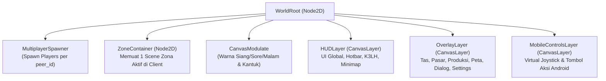
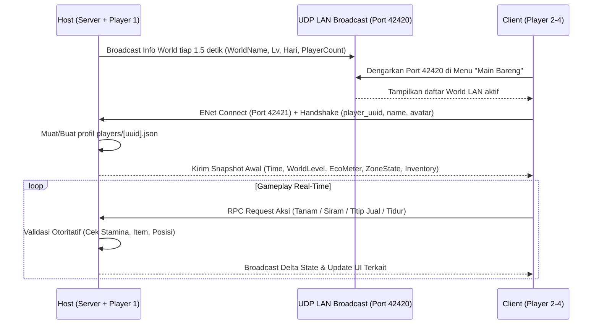

# Arsitektur Teknis Godot 4 & Multiplayer LAN — Nusantara Farm: Petualangan Desa

Dokumen ini menjadi panduan teknis bagi programmer Godot untuk membangun game dari nol secara bersih, modular, tahan *scale-up* ke Fase 2, dan mendukung **Single-Player maupun Co-op LAN 1–4 Pemain** di **Android & PC**.

---

## Daftar Isi
1. [Konfigurasi Project Godot 4](#1-konfigurasi-project-godot-4)
2. [Struktur Direktori Proyek](#2-struktur-direktori-proyek)
3. [Hierarki Scene Utama & Manajemen Multi-Zona](#3-hierarki-scene-utama--manajemen-multi-zona)
4. [Arsitektur Autoload (Singletons)](#4-arsitektur-autoload-singletons)
5. [Skema Custom Resources (.tres / .gd)](#5-skema-custom-resources-tres--gd)
6. [Arsitektur Sistem Pertanian, Produksi & Konsinyasi](#6-arsitektur-sistem-pertanian-produksi--konsinyasi)
7. [Desain Detail Multiplayer Co-op LAN / Hotspot](#7-desain-detail-multiplayer-co-op-lan--hotspot)
8. [Skema Sistem Save & Load Modular](#8-skema-sistem-save--load-modular)
9. [Sistem Kontrol Cross-Platform & Kamera Pixel-Perfect](#9-sistem-kontrol-cross-platform--kamera-pixel-perfect)

---

## 1. Konfigurasi Project Godot 4

### 1.1 Project Settings Inti
| Kategori Setting | Parameter Godot | Nilai Rekomendasi | Alasan Teknis |
| :--- | :--- | :--- | :--- |
| **Renderer** | `rendering/renderer/rendering_method` | `gl_compatibility` | Kompatibilitas terbaik di Android OpenGL ES 3 & PC spek rendah. |
| **Viewport Width** | `display/window/size/viewport_width` | `480` | Grid pixel art `16:9` (30 tile lebar); pas untuk HUD Android. |
| **Viewport Height** | `display/window/size/viewport_height` | `270` | Skala integer pas `4x` ke `1920x1080` (`16:9`). |
| **Window Override** | `display/window/size/window_width_override` | `1280` (atau `960`) | Ukuran jendela awal yang nyaman saat uji coba di desktop. |
| **Stretch Mode** | `display/window/stretch/mode` | `viewport` | Menjaga rasio piksel tetap seragam tanpa artefak *half-pixel*. |
| **Stretch Aspect** | `display/window/stretch/aspect` | `expand` | Mengisi layar Android rasio lebar (`20:9`) tanpa kotak hitam (*letterbox*) sambil menjaga elemen HUD berbasis Anchor tetap rapi. |
| **Texture Filter Default** | `rendering/textures/canvas_textures/default_texture_filter` | `Nearest` | Semua sprite pixel art otomatis tajam tanpa perlu set manual per gambar. |
| **2D Snap** | `rendering/2d/snap/snap_2d_transforms_to_pixel` & `snap_2d_vertices_to_pixel` | `true` | Mencegah *pixel shimmer* dan garis celah antar tile saat kamera bergerak. |
| **Physics Ticks** | `physics/common/physics_ticks_per_second` | `60` | Konsistensi pergerakan karakter dan sinkronisasi jaringan. |

### 1.2 Input Map Terpadu
Gunakan nama aksi berbahasa Inggris yang konsisten untuk keyboard/gamepad, sementara sentuhan Android disalurkan lewat `MobileInput` + UI Button:
- Gerak: `move_up` (`W`/`Up`), `move_down` (`S`/`Down`), `move_left` (`A`/`Left`), `move_right` (`D`/`Right`).
- Aksi Utama (Alat/Tanam/Siram): `action_use` (`Space` / `Mouse Left`).
- Interaksi (NPC/Pintu/Mesin/Kasur): `action_interact` (`E` / `Mouse Right`).
- Menu Cepat: `ui_inventory` (`Tab`/`B`), `ui_map` (`M`), `ui_profile` (`P`), `ui_pause` (`Esc`).
- Hotbar: `hotbar_1` .. `hotbar_6` (`1`–`6`, plus `hotbar_next`/`hotbar_prev` lewat `Mouse Wheel`).

---

## 2. Struktur Direktori Proyek

```text
res://
├── autoloads/                  # Singleton global (tidak terikat scene tertentu)
│   ├── game_manager.gd
│   ├── network_manager.gd
│   ├── time_manager.gd
│   ├── world_state_manager.gd
│   ├── economy_manager.gd
│   ├── k3lh_manager.gd
│   ├── dialogue_manager.gd
│   ├── quest_manager.gd
│   ├── audio_manager.gd
│   ├── mobile_input.gd
│   └── save_manager.gd
├── data/                       # Instance .tres (semua item, crop, resep, quest, NPC)
│   ├── items/
│   ├── crops/
│   ├── recipes/
│   ├── quests/
│   ├── npcs/
│   └── zones/
├── scripts/                    # Kelas dasar & logika komponen
│   ├── resources/              # Definisi class_name Resource (.gd)
│   ├── world/                  # GameZone, Portal, EcoTree, FarmPlotManager
│   ├── actors/                 # PlayerController, NPCController
│   ├── farming/                # FarmPlot, CropInstance, ProductionStation
│   └── network/                # LanDiscovery, PacketSchemas
├── scenes/
│   ├── main/                   # Boot, MainMenu, CharacterCreator, LanLobby, WorldRoot
│   ├── zones/                  # 6 Zona Outdoor (kebun, desa_pasar, hutan, sawit, pantai, tambang)
│   ├── interiors/              # joglo_interior, balai_desa, toko_pasar
│   ├── actors/                 # Player.tscn, NPC.tscn
│   ├── objects/                # FarmPlot.tscn, TreeSpot.tscn, ProductionStation.tscn, ShippingBin.tscn, Bed.tscn
│   └── ui/                     # HUD, MobileControls, InventoryUI, ProductionUI, MarketUI, MapUI, ProfileUI, DialogueUI, K3LHModal, SettingsUI
├── assets/                     # Diisi nanti sesuai Dokumen 03
└── audio/                      # Diisi nanti sesuai Dokumen 03
```

---

## 3. Hierarki Scene Utama & Manajemen Multi-Zona

Di prototype lama, berpindah map memakai `get_tree().change_scene_to_file()` yang menghancurkan seluruh node lama dan mustahil dipakai untuk Co-op LAN ketika 2 pemain berada di map yang berbeda. Pada versi baru, game menggunakan satu root persistent `WorldRoot.tscn`.



### 3.1 Cara Kerja Multi-Zona di Single-Player & Co-op LAN
- **Di sisi Data (`WorldStateManager` di Host):** Seluruh logika perubahan tanaman (`farm_plots`), pohon hutan (`forest_trees`), stasiun produksi (`machines`), dan jadwal NPC **disimpan & disimulasikan secara terpusat berbasis data**, bukan bergantung pada apakah scene `TileMapLayer`-nya sedang tampil di layar.
- **Di sisi Visual (Local Client & Host View):** Masing-masing perangkat hanya memuat **1 scene zona visual aktif** di dalam `ZoneContainer` (yaitu zona tempat pemain lokal perangkat tersebut sedang berdiri!).
  - Saat Pemain A masuk ke portal Hutan, **hanya perangkat Pemain A** yang mengganti isi `ZoneContainer` ke `zona_hutan.tscn` dan memanggil `WorldStateManager` / Host untuk meminta *snapshot* objek zona tersebut.
  - Pemain B yang masih di Kebun tetap melihat `zona_kebun.tscn` tanpa gangguan!
  - Setiap `Player.tscn` menyimpan properti sinkron `current_zone_id`. Di perangkat klien, avatar pemain lain otomatis `visible = (remote_player.current_zone_id == local_player.current_zone_id)` dan collision-nya hanya aktif jika berada di zona yang sama!

### 3.2 Struktur Standar Scene Zona (`GameZone.tscn`)
Setiap zona outdoor mewarisi skrip dasar `GameZone.gd` dengan susunan layer konsisten:
1. `GroundLayer` (`TileMapLayer`): Tanah, rumput, jalan desa, pasir, perairan.
2. `DetailLayer` (`TileMapLayer`): Dekorasi batu kecil, bunga, jembatan, rel/garis batas.
3. `FarmSoilLayer` (`TileMapLayer`): Khusus zona bertanam (Kebun & Sawit) untuk menampilkan tanah tercangkul & basah.
4. `YSortRoot` (`Node2D` dengan `y_sort_enabled = true`): Menampung `Player`, `NPC`, `Crop`, `TreeSpot`, bangunan eksterior, dan prop agar kedalaman depan/belakang (*depth sorting*) otomatis akurat!
5. `Portals` (`Node2D`): Berisi node `ZonePortal` (`Area2D`) dengan `target_zone_id` dan `target_spawn_marker`.
6. `SpawnPoints` (`Node2D`): Kumpulan `Marker2D` tempat karakter muncul saat datang dari zona lain.

---

## 4. Arsitektur Autoload (Singletons)

Urutan muat di `project.godot` direkomendasikan sebagai berikut:

| No | Autoload | Tanggung Jawab Utama | Sinyal Kunci |
| :-: | :--- | :--- | :--- |
| 1 | `GameManager` | Alur transisi Main Menu → Lobby → WorldRoot; simpan profil lokal (`player_uuid`, pilihan `budi`/`mitha`, pengaturan user). | `game_state_changed(new_state)` |
| 2 | `AudioManager` | Putar BGM dengan *crossfade*, layer Ambience cuaca/waktu, dan pool `AudioStreamPlayer` untuk SFX. | `volume_changed(bus, value)` |
| 3 | `MobileInput` | Menyimpan vektor virtual joystick dan flag platform sentuh (diadopsi & dirapikan dari prototype lama). | `input_device_changed(is_touch)` |
| 4 | `NetworkManager` | Manajemen `ENetMultiplayerPeer` (Host/Client), UDP LAN Discovery broadcast & listener, registrasi pemain, dan sinkronisasi koneksi. | `player_connected(peer_id, profile)`, `player_disconnected(peer_id)`, `lan_world_found(info)` |
| 5 | `TimeManager` | Siklus waktu `1 menit nyata = 1 jam in-game`, musim Kemarau/Penghujan (14 hari/musim), cuaca harian, konsensus tidur Co-op, dan status **Debuff Mengantuk**. | `minute_tick(hour, minute)`, `hour_passed(hour)`, `day_passed(day, season)`, `sleep_vote_updated(ready, total)` |
| 6 | `WorldStateManager` | State otoritatif di Host: **World Level & EXP bersama**, unlock zona, kamus petak kebun (`Vector2i -> PlotState`), pohon hutan & **Eco-Meter**, antrian mesin Joglo, dan **Reputasi Desa**. | `world_level_up(new_level)`, `eco_meter_changed(new_val)`, `plot_updated(zone, coords)`, `zone_unlocked(zone_id)` |
| 7 | `EconomyManager` | Dompet Koin pribadi tiap pemain, **Tas Pinggang**, daftar **Titip Jual / Konsinyasi Pasar** (timer jam laku & klaim), serta **Peti Panen** harian. | `coins_changed(player_id, amount)`, `inventory_changed(player_id)`, `consignment_sold(player_id, order_id)` |
| 8 | `QuestManager` | Manajemen quest aktif, pelacakan syarat item/aksi, pencairan hadiah World EXP, Koin, dan peningkatan Eco-Meter. | `quest_accepted(quest_id)`, `quest_completed(quest_id)` |
| 9 | `DialogueManager` | Parser dialog bercabang JSON/Resource, integrasi UI typewriter + potret NPC + poin hati NPC. | `dialogue_started`, `dialogue_ended` |
| 10 | `K3LHManager` | Timer waktu bermain real-time (`60 menit` default, pause-aware), tampilkan modal istirahat, serta kalkulasi penalti Eco-Meter `< 50`. | `break_reminder_triggered`, `eco_crisis_changed(is_crisis)` |
| 11 | `SaveManager` | Serialisasi & deserialisasi atomik `world_state.json` dan `players/<uuid>.json` pada Host. | `save_completed(success)` |

---

## 5. Skema Custom Resources (`.tres` / `.gd`)

Menggunakan `Resource` Godot memungkinkan desainer menambah tanaman, resep, atau NPC baru langsung dari Inspector tanpa mengubah logika kode.

```gdscript
# res://scripts/resources/item_data.gd
class_name ItemData
extends Resource

enum Category { TOOL, SEED, CROP, PROCESSED, FORAGE, MATERIAL, QUEST_ITEM, FISH, ORE, ANIMAL_PRODUCT }

@export var id: StringName
@export var display_name: String
@export_multiline var description: String
@export var category: Category = Category.CROP
@export var icon: Texture2D
@export var max_stack: int = 99
@export var base_buy_price: int = 0
@export var base_sell_price: int = 10
@export var is_consumable: bool = false
@export var energy_restore: int = 0
@export var anti_drowsy_hours: float = 0.0 # Khusus Kopi Seduh Nusantara
@export var is_giftable: bool = true
```

```gdscript
# res://scripts/resources/crop_data.gd
class_name CropData
extends Resource

@export var crop_id: StringName
@export var seed_item_id: StringName
@export var harvest_item_id: StringName
@export var display_name: String
@export var optimal_seasons: Array[StringName] = [&"kemarau", &"penghujan"]
@export var grow_days_normal: int = 5
@export var grow_days_optimal: int = 4
@export var is_regrowable: bool = false
@export var regrow_days: int = 3
@export var min_yield: int = 1
@export var max_yield: int = 3
@export var harvest_xp: int = 10
@export var stage_textures: Array[Texture2D] # 4-5 frame pertumbuhan
```

```gdscript
# res://scripts/resources/recipe_data.gd
class_name RecipeData
extends Resource

@export var recipe_id: StringName
@export var station_type: StringName # &"wajan_joglo", &"lesung", &"sangrai", &"peras", &"dapur_besar"
@export var required_world_level: int = 1
@export var ingredients: Dictionary = {} # { &"pisang": 10, &"minyak_sawit": 1 }
@export var output_item_id: StringName
@export var output_amount: int = 1
@export var process_hours: float = 2.0
@export var craft_xp: int = 15
```

```gdscript
# res://scripts/resources/npc_data.gd
class_name NPCData
extends Resource

@export var npc_id: StringName
@export var display_name: String
@export var role_title: String
@export var portraits: Dictionary = {} # { &"neutral": Texture2D, &"happy": Texture2D, &"concerned": Texture2D }
@export var liked_items: Array[StringName] = []
@export var disliked_items: Array[StringName] = []
@export var daily_schedule: Dictionary = {} # { 6: { "zone": "desa_pasar", "pos": Vector2(...) }, ... }
```

---

## 6. Arsitektur Sistem Pertanian, Produksi & Konsinyasi

### 6.1 State Machine Petak Lahan (`PlotState`)
Di `WorldStateManager`, setiap petak pada grid `16x16` disimpan sebagai dictionary ringan (hanya tile yang termodifikasi yang disimpan agar file save hemat memori):

```text
{
  "soil_state": 0 (KOSONG) | 1 (CANGKUL_KERING) | 2 (CANGKUL_BASAH),
  "crop_id": "padi_lokal",
  "days_grown": 2,
  "is_mature": false,
  "empty_days": 0
}
```
- **Saat `day_passed` di Host:**
  - Jika `crop_id != ""` dan `soil_state == 2` (atau cuaca hari kemarin `hujan`): `days_grown += 1`. Bandingkan dengan `grow_days` (memperhitungkan bonus musim optimal) → set `is_mature = true`.
  - Reset `soil_state` dari `2` (basah) menjadi `1` (kering), kecuali hari baru langsung berstatus cuaca **Hujan** maka seluruh petak terbuka otomatis di-set ke `2` (basah)!
  - Jika `crop_id == ""` dan `soil_state == 1`: `empty_days += 1`; bila `empty_days >= 3`, hapus entri petak (kembali menjadi tanah biasa).

### 6.2 Simulasi Timer Produksi Joglo & Konsinyasi Pasar
- **Stasiun Produksi Joglo:** Menyimpan struktur `{ "station_id": { "recipe_id", "owner_uuid", "hours_remaining", "completed": bool } }`.
- **Konsinyasi Pasar (`ConsignmentOrder`):**
  ```text
  {
    "order_id": "ord_0012",
    "seller_uuid": "uuid-player-1",
    "item_id": "keripik_pisang",
    "amount": 2,
    "hours_remaining": 4.0,
    "payout_coins": 1104, # sudah termasuk bonus konsinyasi & bonus Eco-Meter
    "is_sold": false
  }
  ```
- Setiap sinyal `TimeManager.hour_passed` berbunyi di Host, `hours_remaining` pada mesin produksi dan kontrak konsinyasi berkurang `-1.0`. Begitu `hours_remaining <= 0`, Host menandai `is_sold = true` / `completed = true` dan mengirim RPC notifikasi ringan ke pemiliknya!

---

## 7. Desain Detail Multiplayer Co-op LAN / Hotspot

### 7.1 Arsitektur Jaringan (Host-Authoritative)



### 7.2 Parameter Teknis Koneksi LAN
- **UDP Discovery Port:** `42420` (broadcast ke `255.255.255.255` atau subnet broadcast lokal tiap `1.5 detik` selama lobby terbuka).
- **ENet Game Port:** `42421` (maksimal `3` remote peer = total `4` pemain bersama Host).
- **Direct IP Fallback:** Jika hotspot Android tertentu membatasi UDP broadcast antar klien, layar *Main Bareng* menyediakan input IP Manual (contoh: `192.168.43.1` untuk hotspot Android standar) serta menampilkan IP lokal Host secara jelas di layar Host agar mudah dibaca teman.

### 7.3 Protokol Sinkronisasi & Konsensus
1. **Pergerakan Karakter (`PlayerSync`):** Menggunakan `MultiplayerSynchronizer` (`unreliable_ordered`, `replication_interval = 0.05s`) untuk posisi, arah hadap, dan state animasi; interpolasi ringan (`lerp`) di klien lain agar gerak tetap mulus.
2. **Aksi Dunia & Anti-Duplikasi:** Seluruh pengurangan item, pemakaian alat, panen tanaman, tebang pohon, pengisian mesin Joglo, dan penitipan barang Pasar diproses **hanya di Host**. Klien mengirim `@rpc("any_peer", "call_local", "reliable")` lalu menunggu konfirmasi Host sebelum memperbarui slot UI atau menumbuhkan tanaman.
3. **Konsensus Tidur Malam:**
   - Saat pemain menekan tombol tidur di kasur pada `18:00–05:59`, ia mengirim `request_toggle_sleep(true)` ke Host.
   - Host mencatat set `sleeping_peers`. Jika `sleeping_peers.size() == active_players.size()` → Host memicu `advance_day_by_sleep()` untuk semua pemain!
   - Jika pemain bergerak menjauh dari kasur atau membatalkan tidur, ia otomatis mengirim `request_toggle_sleep(false)`.

---

## 8. Skema Sistem Save & Load Modular

Agar progres **World** dan progres **Pribadi Pemain** selaras dengan aturan Co-op, save disimpan di `user://saves/<world_id>/`:

```text
user://saves/desa_subur_01/
├── world_meta.json         # Ringkasan untuk kartu Load Game (nama, world_lv, hari, musim, terakhir main)
├── world_state.json        # Data milik World: world_lv, world_xp, eco_meter, day, season, weather,
│                           # unlocked_zones, farm_plots, forest_trees, active_machines, shipping_bin,
│                           # consignment_orders, shared_chest_items
└── players/
    ├── <host_uuid>.json    # Nama, avatar (budi/mitha), coins, stamina, is_drowsy, skills, inventory, npc_hearts, quests
    └── <guest_uuid>.json   # Data pribadi teman yang pernah join ke world ini!
```

### Keamanan Save & Auto-Save
- **Pemicu Auto-Save (di Host):** Setiap pergantian hari (`06:00`), saat membuka gerbang zona baru, saat pemain keluar dari world, dan interval berkala tiap `5 menit` (menulis file `.tmp` lalu menimpa file utama untuk mencegah file rusak).
- **Identitas Client (`player_uuid`):** Saat game dijalankan pertama kali di perangkat mana pun, `GameManager` membuat `UUID` unik yang disimpan di `user://client_profile.json`. Dengan begitu, jika Budi bergabung ke world temannya hari ini lalu bergabung lagi besok via HP yang sama, koin, level keahlian, dan isi Tas Pinggangnya tetap utuh!

---

## 9. Sistem Kontrol Cross-Platform & Kamera Pixel-Perfect

### 9.1 Kamera Anti-Jitter
- Menggunakan `Camera2D` pada Player lokal dengan batas map (`limit_left`, `limit_top`, `limit_right`, `limit_bottom`) sesuai ukuran `GameZone` aktif.
- Posisi kamera dan sprite dibulatkan pada tahap render (didukung setting `snap_2d_transforms_to_pixel = true`) agar pixel tidak bergetar saat karakter berjalan diagonal.

### 9.2 Highlight Petak Target (Grid Cursor)
- Untuk memudahkan pemain baik memakai **Mouse (PC)** maupun **Virtual Joystick (Android)**:
  - **Di PC:** Petak target mengikuti posisi kursor mouse jika berada dalam radius `1.5 tile` dari karakter; jika tidak, mengikuti `1 tile` di depan arah hadap karakter.
  - **Di Android:** Petak target otomatis mengunci `1 tile` tepat di depan arah hadap karakter (ditandai kotak garis putus-putus tipis berwarna kuning-hijau), dan pemain juga bisa langsung mengetuk (*tap*) petak yang berada tepat di sebelah karakter!
- Tombol `MobileControlsLayer` (Virtual Joystick + Tombol Aksi Alat + Tombol Interaksi NPC/Pintu) muncul otomatis pada perangkat Android/layar sentuh (dan dapat diaktifkan lewat menu debug/pengaturan di PC untuk pengujian).
